# Generated architecture inventory

STATIC_REFERENCE — NOT_DEPLOYED. Arrows show template references/dependencies, not observed network traffic. Implicit service behavior and references embedded in Fn::Sub strings are not inferred.

| Stack | Type | Count |
|---|---|---|
| BankItLabNetworkDatabase | AWS::Backup::BackupPlan | 1 |
| BankItLabNetworkDatabase | AWS::Backup::BackupSelection | 1 |
| BankItLabNetworkDatabase | AWS::Backup::BackupVault | 1 |
| BankItLabNetworkDatabase | AWS::EC2::FlowLog | 1 |
| BankItLabNetworkDatabase | AWS::EC2::RouteTable | 4 |
| BankItLabNetworkDatabase | AWS::EC2::SecurityGroup | 4 |
| BankItLabNetworkDatabase | AWS::EC2::SecurityGroupEgress | 3 |
| BankItLabNetworkDatabase | AWS::EC2::SecurityGroupIngress | 3 |
| BankItLabNetworkDatabase | AWS::EC2::Subnet | 4 |
| BankItLabNetworkDatabase | AWS::EC2::SubnetRouteTableAssociation | 4 |
| BankItLabNetworkDatabase | AWS::EC2::VPC | 1 |
| BankItLabNetworkDatabase | AWS::EC2::VPCEndpoint | 1 |
| BankItLabNetworkDatabase | AWS::IAM::ManagedPolicy | 3 |
| BankItLabNetworkDatabase | AWS::IAM::Role | 4 |
| BankItLabNetworkDatabase | AWS::KMS::Key | 2 |
| BankItLabNetworkDatabase | AWS::Lambda::Function | 1 |
| BankItLabNetworkDatabase | AWS::Logs::LogGroup | 3 |
| BankItLabNetworkDatabase | AWS::RDS::DBInstance | 1 |
| BankItLabNetworkDatabase | AWS::RDS::DBParameterGroup | 1 |
| BankItLabNetworkDatabase | AWS::RDS::DBSubnetGroup | 1 |
| BankItLabNetworkDatabase | AWS::SecretsManager::ResourcePolicy | 1 |
| BankItLabNetworkDatabase | AWS::SecretsManager::RotationSchedule | 1 |
| BankItLabNetworkDatabase | AWS::SecretsManager::Secret | 1 |
| BankItLabNetworkDatabase | AWS::SecretsManager::SecretTargetAttachment | 1 |
| BankItLabNetworkDatabase | AWS::Serverless::Application | 1 |
| BankItLabNetworkDatabase | Custom::VpcRestrictDefaultSG | 1 |
| BankItLabSecureStorage | AWS::KMS::Key | 1 |
| BankItLabSecureStorage | AWS::S3::Bucket | 2 |
| BankItLabSecureStorage | AWS::S3::BucketPolicy | 2 |

### AppSecurityGroupC396D536 (BankItLabNetworkDatabase)

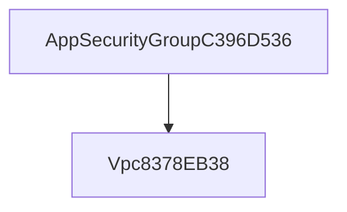

### AppSecurityGrouptoBankItLabNetworkDatabaseDatabaseSecurityGroupA915ECBB5433BE79485C (BankItLabNetworkDatabase)

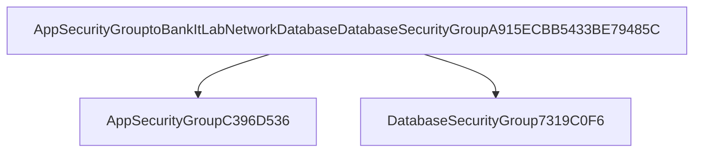

### BackupPlanA8F64793 (BankItLabNetworkDatabase)

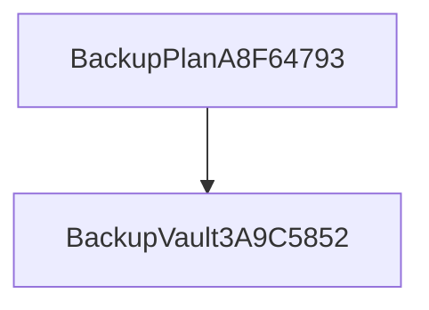

### BackupVault3A9C5852 (BankItLabNetworkDatabase)

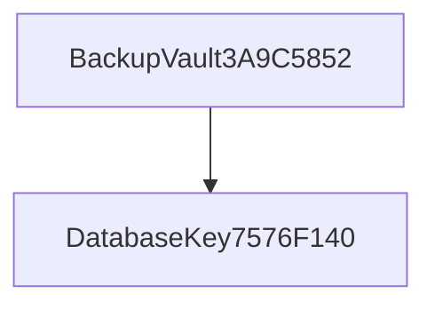

### BankItLabNetworkDatabasePostgresSecretA3DF6E373fdaad7efa858a3daf9490cf0a702aeb (BankItLabNetworkDatabase)

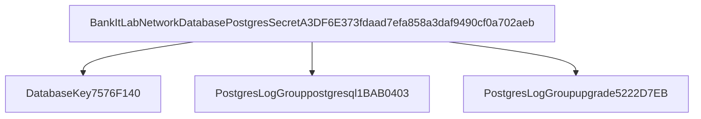

### CustomVpcRestrictDefaultSGCustomResourceProviderHandlerDC833E5E (BankItLabNetworkDatabase)

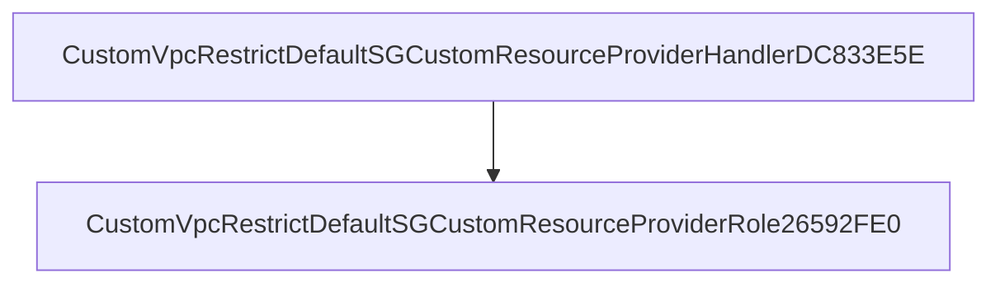

### CustomVpcRestrictDefaultSGCustomResourceProviderRole26592FE0 (BankItLabNetworkDatabase)

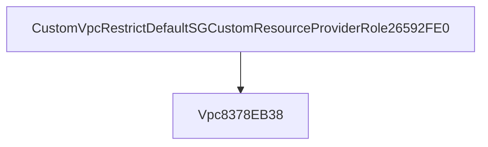

### DatabaseSecurityGroup7319C0F6 (BankItLabNetworkDatabase)

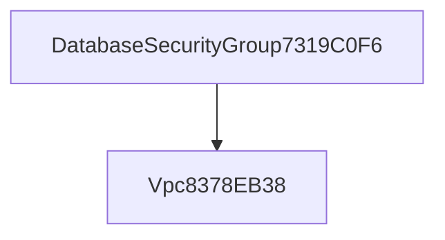

### DatabaseSecurityGroupfromBankItLabNetworkDatabaseAppSecurityGroup920027D35433995D19B4 (BankItLabNetworkDatabase)

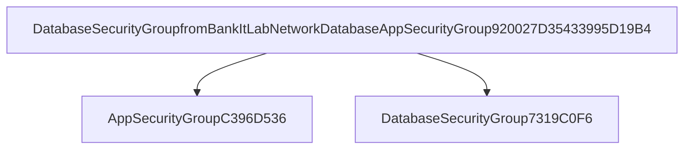

### DatabaseSecurityGroupfromBankItLabNetworkDatabaseRotationSecurityGroup745D3E3BIndirectPortF4767FC1 (BankItLabNetworkDatabase)

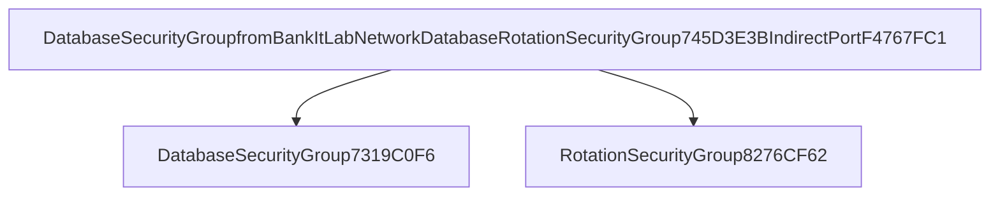

### DbBackupPolicy43A4FBCE (BankItLabNetworkDatabase)

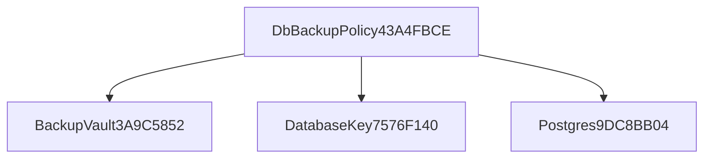

### DbBackupRoleB234430F (BankItLabNetworkDatabase)

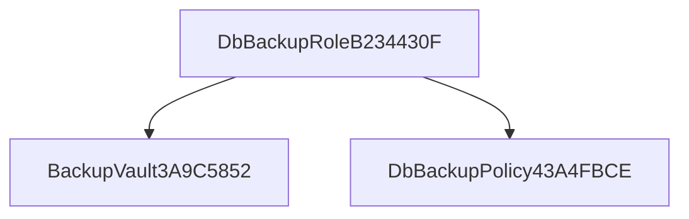

### FlowLogGroup3E25AA51 (BankItLabNetworkDatabase)

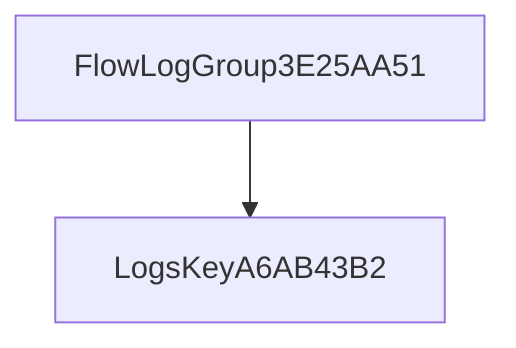

### FlowLogPolicyB9FF45F2 (BankItLabNetworkDatabase)

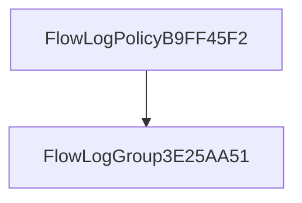

### FlowLogRoleCB27E7DF (BankItLabNetworkDatabase)

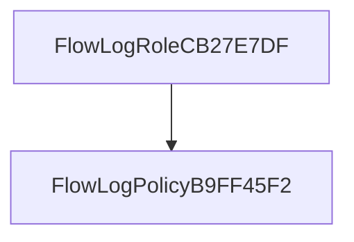

### Postgres9DC8BB04 (BankItLabNetworkDatabase)

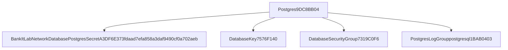

### Postgres9DC8BB04 (BankItLabNetworkDatabase)

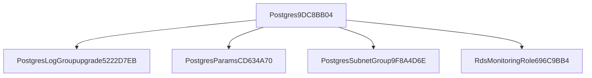

### PostgresLogGrouppostgresql1BAB0403 (BankItLabNetworkDatabase)

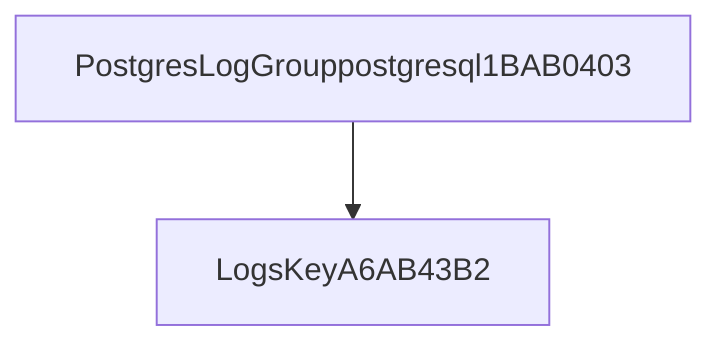

### PostgresLogGroupupgrade5222D7EB (BankItLabNetworkDatabase)

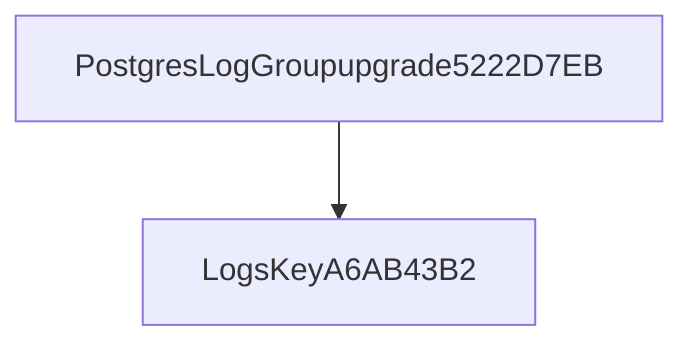

### PostgresRotationSingleUserA53C71BD (BankItLabNetworkDatabase)

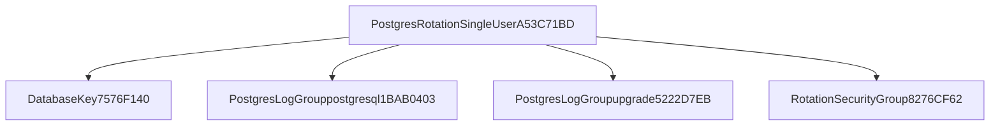

### PostgresRotationSingleUserA53C71BD (BankItLabNetworkDatabase)

```mermaid
flowchart TD
  source["PostgresRotationSingleUserA53C71BD"]
  n0["VpcSecretsManagerEndpoint93E49F69"]
  source --> n0
  n1["VpcappSubnet1SubnetAE489B2F"]
  source --> n1
  n2["VpcappSubnet2Subnet2449FB56"]
  source --> n2
```

### PostgresSecretAttachment75CD6F6F (BankItLabNetworkDatabase)

```mermaid
flowchart TD
  source["PostgresSecretAttachment75CD6F6F"]
  n0["BankItLabNetworkDatabasePostgresSecretA3DF6E373fdaad7efa858a3daf9490cf0a702aeb"]
  source --> n0
  n1["Postgres9DC8BB04"]
  source --> n1
  n2["PostgresLogGrouppostgresql1BAB0403"]
  source --> n2
  n3["PostgresLogGroupupgrade5222D7EB"]
  source --> n3
```

### PostgresSecretAttachmentPolicy00772C69 (BankItLabNetworkDatabase)

```mermaid
flowchart TD
  source["PostgresSecretAttachmentPolicy00772C69"]
  n0["PostgresLogGrouppostgresql1BAB0403"]
  source --> n0
  n1["PostgresLogGroupupgrade5222D7EB"]
  source --> n1
  n2["PostgresSecretAttachment75CD6F6F"]
  source --> n2
```

### PostgresSecretAttachmentRotationScheduleBF85CA02 (BankItLabNetworkDatabase)

```mermaid
flowchart TD
  source["PostgresSecretAttachmentRotationScheduleBF85CA02"]
  n0["PostgresLogGrouppostgresql1BAB0403"]
  source --> n0
  n1["PostgresLogGroupupgrade5222D7EB"]
  source --> n1
  n2["PostgresRotationSingleUserA53C71BD"]
  source --> n2
  n3["PostgresSecretAttachment75CD6F6F"]
  source --> n3
```

### PostgresSelection (BankItLabNetworkDatabase)

```mermaid
flowchart TD
  source["PostgresSelection"]
  n0["BackupPlanA8F64793"]
  source --> n0
  n1["DbBackupRoleB234430F"]
  source --> n1
  n2["Postgres9DC8BB04"]
  source --> n2
```

### PostgresSubnetGroup9F8A4D6E (BankItLabNetworkDatabase)

```mermaid
flowchart TD
  source["PostgresSubnetGroup9F8A4D6E"]
  n0["PostgresLogGrouppostgresql1BAB0403"]
  source --> n0
  n1["PostgresLogGroupupgrade5222D7EB"]
  source --> n1
  n2["VpcdbSubnet1Subnet1B82B149"]
  source --> n2
  n3["VpcdbSubnet2Subnet01192A3B"]
  source --> n3
```

### RdsMonitoringRole696C9BB4 (BankItLabNetworkDatabase)

```mermaid
flowchart TD
  source["RdsMonitoringRole696C9BB4"]
  n0["RdsMonitoringPolicy5DA8ACAC"]
  source --> n0
```

### RotationSecurityGroup8276CF62 (BankItLabNetworkDatabase)

```mermaid
flowchart TD
  source["RotationSecurityGroup8276CF62"]
  n0["Vpc8378EB38"]
  source --> n0
```

### RotationSecurityGrouptoBankItLabNetworkDatabaseDatabaseSecurityGroupA915ECBBIndirectPort434D1737 (BankItLabNetworkDatabase)

```mermaid
flowchart TD
  source["RotationSecurityGrouptoBankItLabNetworkDatabaseDatabaseSecurityGroupA915ECBBIndirectPort434D1737"]
  n0["DatabaseSecurityGroup7319C0F6"]
  source --> n0
  n1["RotationSecurityGroup8276CF62"]
  source --> n1
```

### RotationSecurityGrouptoBankItLabNetworkDatabaseSecretsManagerEndpointSecurityGroup395F6736443630B3C70 (BankItLabNetworkDatabase)

```mermaid
flowchart TD
  source["RotationSecurityGrouptoBankItLabNetworkDatabaseSecretsManagerEndpointSecurityGroup395F6736443630B3C70"]
  n0["RotationSecurityGroup8276CF62"]
  source --> n0
  n1["SecretsManagerEndpointSecurityGroup4198229B"]
  source --> n1
```

### SecretsManagerEndpointSecurityGroup4198229B (BankItLabNetworkDatabase)

```mermaid
flowchart TD
  source["SecretsManagerEndpointSecurityGroup4198229B"]
  n0["Vpc8378EB38"]
  source --> n0
```

### SecretsManagerEndpointSecurityGroupfromBankItLabNetworkDatabaseRotationSecurityGroup745D3E3B443FFC9B240 (BankItLabNetworkDatabase)

```mermaid
flowchart TD
  source["SecretsManagerEndpointSecurityGroupfromBankItLabNetworkDatabaseRotationSecurityGroup745D3E3B443FFC9B240"]
  n0["RotationSecurityGroup8276CF62"]
  source --> n0
  n1["SecretsManagerEndpointSecurityGroup4198229B"]
  source --> n1
```

### VpcFlowLog8FF33A73 (BankItLabNetworkDatabase)

```mermaid
flowchart TD
  source["VpcFlowLog8FF33A73"]
  n0["FlowLogGroup3E25AA51"]
  source --> n0
  n1["FlowLogRoleCB27E7DF"]
  source --> n1
  n2["Vpc8378EB38"]
  source --> n2
```

### VpcRestrictDefaultSecurityGroupCustomResourceC73DA2BE (BankItLabNetworkDatabase)

```mermaid
flowchart TD
  source["VpcRestrictDefaultSecurityGroupCustomResourceC73DA2BE"]
  n0["CustomVpcRestrictDefaultSGCustomResourceProviderHandlerDC833E5E"]
  source --> n0
  n1["Vpc8378EB38"]
  source --> n1
```

### VpcSecretsManagerEndpoint93E49F69 (BankItLabNetworkDatabase)

```mermaid
flowchart TD
  source["VpcSecretsManagerEndpoint93E49F69"]
  n0["SecretsManagerEndpointSecurityGroup4198229B"]
  source --> n0
  n1["Vpc8378EB38"]
  source --> n1
  n2["VpcappSubnet1SubnetAE489B2F"]
  source --> n2
  n3["VpcappSubnet2Subnet2449FB56"]
  source --> n3
```

### VpcappSubnet1RouteTable072E8E09 (BankItLabNetworkDatabase)

```mermaid
flowchart TD
  source["VpcappSubnet1RouteTable072E8E09"]
  n0["Vpc8378EB38"]
  source --> n0
```

### VpcappSubnet1RouteTableAssociation168BF781 (BankItLabNetworkDatabase)

```mermaid
flowchart TD
  source["VpcappSubnet1RouteTableAssociation168BF781"]
  n0["VpcappSubnet1RouteTable072E8E09"]
  source --> n0
  n1["VpcappSubnet1SubnetAE489B2F"]
  source --> n1
```

### VpcappSubnet1SubnetAE489B2F (BankItLabNetworkDatabase)

```mermaid
flowchart TD
  source["VpcappSubnet1SubnetAE489B2F"]
  n0["Vpc8378EB38"]
  source --> n0
```

### VpcappSubnet2RouteTableAssociation81E96A75 (BankItLabNetworkDatabase)

```mermaid
flowchart TD
  source["VpcappSubnet2RouteTableAssociation81E96A75"]
  n0["VpcappSubnet2RouteTableB76BFC59"]
  source --> n0
  n1["VpcappSubnet2Subnet2449FB56"]
  source --> n1
```

### VpcappSubnet2RouteTableB76BFC59 (BankItLabNetworkDatabase)

```mermaid
flowchart TD
  source["VpcappSubnet2RouteTableB76BFC59"]
  n0["Vpc8378EB38"]
  source --> n0
```

### VpcappSubnet2Subnet2449FB56 (BankItLabNetworkDatabase)

```mermaid
flowchart TD
  source["VpcappSubnet2Subnet2449FB56"]
  n0["Vpc8378EB38"]
  source --> n0
```

### VpcdbSubnet1RouteTable04184FDD (BankItLabNetworkDatabase)

```mermaid
flowchart TD
  source["VpcdbSubnet1RouteTable04184FDD"]
  n0["Vpc8378EB38"]
  source --> n0
```

### VpcdbSubnet1RouteTableAssociation3FF66701 (BankItLabNetworkDatabase)

```mermaid
flowchart TD
  source["VpcdbSubnet1RouteTableAssociation3FF66701"]
  n0["VpcdbSubnet1RouteTable04184FDD"]
  source --> n0
  n1["VpcdbSubnet1Subnet1B82B149"]
  source --> n1
```

### VpcdbSubnet1Subnet1B82B149 (BankItLabNetworkDatabase)

```mermaid
flowchart TD
  source["VpcdbSubnet1Subnet1B82B149"]
  n0["Vpc8378EB38"]
  source --> n0
```

### VpcdbSubnet2RouteTable7BBEF14D (BankItLabNetworkDatabase)

```mermaid
flowchart TD
  source["VpcdbSubnet2RouteTable7BBEF14D"]
  n0["Vpc8378EB38"]
  source --> n0
```

### VpcdbSubnet2RouteTableAssociation3D000840 (BankItLabNetworkDatabase)

```mermaid
flowchart TD
  source["VpcdbSubnet2RouteTableAssociation3D000840"]
  n0["VpcdbSubnet2RouteTable7BBEF14D"]
  source --> n0
  n1["VpcdbSubnet2Subnet01192A3B"]
  source --> n1
```

### VpcdbSubnet2Subnet01192A3B (BankItLabNetworkDatabase)

```mermaid
flowchart TD
  source["VpcdbSubnet2Subnet01192A3B"]
  n0["Vpc8378EB38"]
  source --> n0
```

### AccessLogsBucketPolicy7F77476F (BankItLabSecureStorage)

```mermaid
flowchart TD
  source["AccessLogsBucketPolicy7F77476F"]
  n0["AccessLogsBucket83982689"]
  source --> n0
  n1["DataBucketE3889A50"]
  source --> n1
```

### DataBucketE3889A50 (BankItLabSecureStorage)

```mermaid
flowchart TD
  source["DataBucketE3889A50"]
  n0["AccessLogsBucket83982689"]
  source --> n0
  n1["DataKey17AFBB84"]
  source --> n1
```

### DataBucketPolicy3231C704 (BankItLabSecureStorage)

```mermaid
flowchart TD
  source["DataBucketPolicy3231C704"]
  n0["DataBucketE3889A50"]
  source --> n0
```
